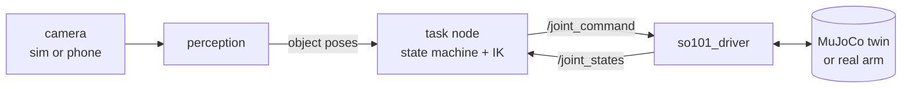

# SO-101 Manipulation Lab

**ROS 2 platform for the SO-101 robot arm: one stack for the MuJoCo digital twin and
the real arm, with camera-guided manipulation projects built on top of it.**

<!-- TODO: demo GIF / video (sim + real arm), e.g. docs/media/pick_place.gif -->

[](https://github.com/NeoBrtn/So101-manipulation/actions/workflows/ci.yml)


| | Project | Status |
|---|---|---|
| 1 | [**Pick & place**](docs/phase1_pick_place.md): a fixed camera finds a cube, the arm drops it in a box, replans if it moves | ✅ Simulation: 28/28 in-view cubes picked |
| 2 | [**Bottle decapping**](docs/phase2_decap.md): lock a bottle in a fixture, unscrew its cap, sort cap and bottle | 🛠 Design |
| 3 | *to come* | |

## Highlights

- **Inverse kinematics with Pinocchio.** A damped least-squares closed-loop IK with a
  weighted error handles the 5-DOF limit, with the yaw free or the jaw direction
  fixed. A *task-priority* mode reaches the position exactly and keeps the
  orientation as close as the arm allows. Joint limits are handled with an active
  set. A full pick & place plans in **≈ 30 ms**.
- **Monocular 3D perception.** Pixel → ray → table-plane intersection, with an
  occlusion-robust tracker. A partly hidden blob or a one-frame jump never makes the
  arm chase a ghost.
- **Sim-to-real by design.** A single driver node talks to either the MuJoCo twin or
  the real Feetech bus. The rest of the stack never knows which one it is. Measured
  joint-zero offsets give the IK, the sim and the real arm the same angles.
- **A camera you can move.** Any phone or webcam stream becomes a ROS camera. Its pose
  is estimated live from one ArUco marker on the table.
- **Explicit, non-blocking state machines.** The control tick never waits on
  perception. Motions are streamed as smooth interpolated waypoints with settle and
  grasp-stall detection.
- **Built to grow.** Shared platform packages, and one package per project, found
  by name. Docker (3 containers), unit tests and CI.

## Architecture



```
ros2_ws/src/
├── platform/                 shared by every project
│   ├── so101_driver          sim / real backend, network camera + ArUco pose, calibration tools
│   ├── so101_manipulation    Pinocchio IK, trajectory streaming, ArmInterface, motion_server
│   ├── so101_vision          camera geometry, segmentation, tracking
│   ├── so101_bringup         launch files + task plug-in convention
│   ├── so101_description     URDF and meshes
│   └── so101_interfaces      services
└── tasks/
    ├── so101_pick_place      project 1
    └── so101_decap           project 2
sim/                          MuJoCo digital twin (same API as the real arm driver)
third_party/lerobot_min/      real arm driver, vendored from LeRobot
docker/                       control / perception / viz containers
```

More: [architecture](docs/architecture.md) · [adding a project](docs/adding_a_task.md) ·
[real robot setup](docs/real_robot.md)

## Quick start (simulation)

Requirements: Docker with Compose. For the RViz and MuJoCo windows: X11 (Linux, or
WSLg on Windows).

```bash
cd docker
cp .env.example .env            # TASK=pick_place, USE_SIM=true
docker compose up -d --build    # first run: builds the images and the workspace

../scripts/pick_place_demo.sh --runs 5    # random cube poses, prints the success rate
../scripts/rviz.sh                        # optional: RViz (xhost +local:docker first)
```

By hand, from `docker compose exec control bash`:

```bash
source install/setup.bash
ros2 service call /reset_object std_srvs/srv/Trigger        # new random cube pose
ros2 service call /pick_and_place std_srvs/srv/Trigger      # one pick & place cycle
ros2 topic echo /pick_place/result
ros2 service call /go_to_target so101_interfaces/srv/GoToTarget \
  "{target_pose: {pose: {position: {x: 0.25, y: 0.0, z: 0.05}}}}"
```

Set `SIM_VIEWER=true` in `.env` for a live MuJoCo window.

## Tests

```bash
scripts/test.sh      # builds and runs the unit tests in the control image, as the CI does
```

The tests cover the IK (round trips, the measured workspace limits, tilted grasps,
straight descents), the planner over the whole cube spawn area, the camera geometry,
the tracker and the trajectory streamer.

## Credits

Built during the Epitech robotics module (Tek5) on the course starter kit: the
SO-101 MuJoCo twin and scene, the Docker base, and the minimal LeRobot driver.

- [LeRobot](https://github.com/huggingface/lerobot) (Hugging Face, Apache-2.0): the
  Feetech / SO-101 driver in `third_party/lerobot_min`
- [SO-ARM100](https://github.com/TheRobotStudio/SO-ARM100) (TheRobotStudio): the arm,
  URDF and meshes
- [Pinocchio](https://github.com/stack-of-tasks/pinocchio), [MuJoCo](https://mujoco.org),
  [OpenCV](https://opencv.org)

## License

[Apache-2.0](LICENSE)
