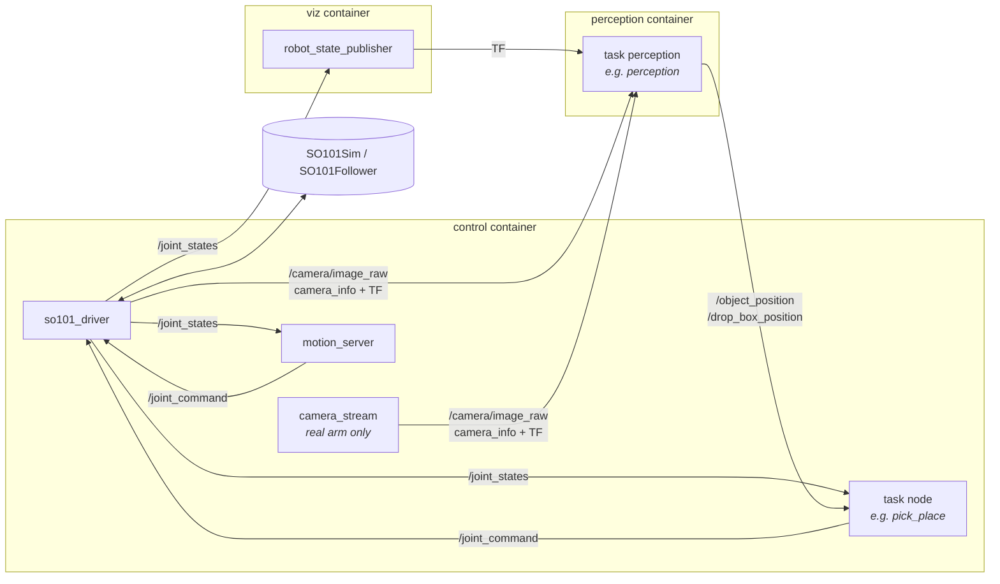

# Architecture

The repository is split into a **platform**, which knows nothing about any particular
application, and **tasks**, one ROS package per project, plugged into the platform.

```
ros2_ws/src/
├── platform/                  shared by every task
│   ├── so101_description      URDF, meshes, robot_state_publisher launch
│   ├── so101_interfaces       services (GoToTarget, SetJointPositions)
│   ├── so101_driver           the only node talking to the arm (sim or real) + real camera
│   ├── so101_manipulation     Pinocchio IK, trajectory streaming, ArmInterface, motion_server
│   ├── so101_vision           camera geometry, colour segmentation, tracking
│   └── so101_bringup          launch files, task plug-in convention, RViz config
└── tasks/
    ├── so101_pick_place       phase 1
    └── so101_decap            phase 2 (design stage)
```

## Nodes and topics



| Topic / service | Type | From → to |
|---|---|---|
| `/joint_states` | `sensor_msgs/JointState` (rad, 50 Hz) | driver → everyone |
| `/joint_command` | `sensor_msgs/JointState` (rad, gripper 0–100 %) | task / motion_server → driver |
| `/<camera>/image_raw`, `/<camera>/camera_info` | `sensor_msgs` | driver (sim) or camera_stream (real) → perception |
| TF `world → <camera>_optical_frame` | | driver (sim, ground truth) or camera_stream (real, live ArUco) |
| `/end_effector_pose` | `geometry_msgs/PoseStamped` | motion_server (FK) |
| `/go_to_target`, `/set_joint_positions` | `so101_interfaces/srv` | motion_server |
| `/reset_object` | `std_srvs/Trigger` | driver (sim only: new random object pose) |

## Design rules

- **One door to the motors.** Only `so101_driver` talks to the backend. Everything
  else commands `/joint_command`. The `use_sim` switch is invisible to the rest of the
  stack: the MuJoCo twin (`SO101Sim`) has the same API as LeRobot's `SO101Follower`.
- **Never block on perception.** Control loops read the last known value with its
  age. Perception only publishes detections it trusts.
- **Same frames in sim and on the real arm.** `world` = `base_link` (robot base at
  the origin, x forward, y left, z up). The camera pose always comes from TF, wherever
  it is estimated.
- **Plan, then move.** A task solves all its IK before moving (≈ 30 ms for a pick &
  place). The control tick then streams interpolated waypoints at 50 Hz. The arm
  subscriptions run in their own callback group, so a long computation never starves
  the state feedback.

## The task plug-in convention

`so101_bringup` starts the platform, then looks up the package `so101_<task>`:

| File in the task's share directory | Used for |
|---|---|
| `config/driver.yaml` | `so101_driver` parameters for this task: sim scene, published camera, object placement |
| `launch/control.launch.py` | the task's control nodes (control container) |
| `launch/perception.launch.py` | the task's perception nodes (perception container), optional |

See [adding_a_task.md](adding_a_task.md).

## Containers

| Container | Image | Runs |
|---|---|---|
| `control` | `so101/control`: ROS 2 Jazzy, MuJoCo, Pinocchio, LeRobot driver, RViz | builds the workspace, then `so101_bringup control.launch.py` |
| `perception` | `so101/perception`: ROS 2 Jazzy, OpenCV (lean) | `so101_bringup perception.launch.py` |
| `viz` | `so101/control` | `robot_state_publisher` |

All three share one bridge network (DDS discovery) and the `ros2_ws` volume. Only
`control` builds; the others wait for its `install/`.

## Real arm specifics

- **Joint zero offsets.** The LeRobot calibration puts each joint's zero in the
  middle of its recorded range, which is not exactly the URDF zero pose.
  `measure_zero` records the difference once, and the driver applies it. The IK, the
  sim and the real arm then share the same angles.
- **Serial link hardening.** Over USB passed to WSL, the bus sometimes drops a reply
  or stalls. Writes get a timeout, a failed control step is skipped, and only a lasting
  failure stops the driver.
- **Camera anywhere.** `camera_stream_node` turns any OpenCV-readable stream (e.g. a
  phone running DroidCam) into a ROS camera. It undistorts the image, and estimates
  its pose live from one ArUco marker on the table, resolving the marker's mirror
  ambiguity with the current estimate.
