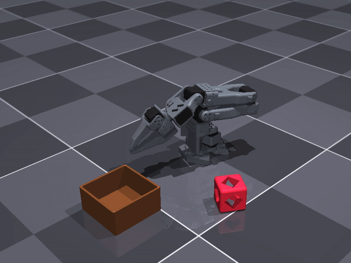
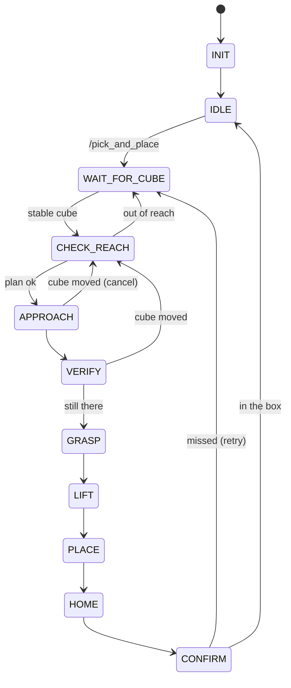

# Phase 1: camera-guided pick & place

**Goal:** a fixed camera spots a red 5 cm cube on the table. The arm picks it up and
drops it in a box. It also handles a cube out of reach, and replans if the cube is
moved during the approach.

Package: [`ros2_ws/src/tasks/so101_pick_place`](../ros2_ws/src/tasks/so101_pick_place)



```
 camera ──► perception ──/object_position──────► pick_place ──/joint_command──► driver
                        ──/drop_box_position──►     ▲                              │
                                                    └──────── /joint_states ───────┘
```

---

## Perception (`perception_node`)

Runs on the latest camera frame at 10 Hz. It never processes a backlog.

1. **HSV mask.** The image is converted to HSV and thresholded on the cube colour. Red
   needs **two hue ranges** (≈ 0–6 and ≈ 160–180) because hue wraps around. The masks
   are OR-ed. Minimum saturation and value reject the grey floor and the arm. A
   morphological opening removes noise. The brown box gets one range.
2. **Blob centre.** The largest connected component above a minimum area gives the
   centroid `(u, v)`. No valid blob means nothing is published, and consumers keep the
   last known value.
3. **Pixel → ray.** Pinhole model, with `K` from `camera_info` and the camera pose
   `(R, O)` from TF:
   `d_cam = K⁻¹ [u, v, 1]`, `d = R · d_cam`
4. **Ray ∩ table plane.** `z_plane` is the cube centre height (the cube lies on the
   table) or the box mid-height:
   `t = (z_plane − O_z) / d_z`, `P = O + t · d`. Rejected if `t ≤ 0`.
5. **Tracker.** When the arm hides part of an object, the centroid of the visible part
   shifts (by up to 15 cm for the box). Detections whose blob is much smaller than
   usual are rejected. A jump away from the estimate is accepted only after 5
   consistent frames. The published value is the median of the last 5 accepted
   detections.
6. **Publish** a `PoseStamped` in `world` (= `base_link`), stamped with the image time.

**Why HSV and not a learned detector:** the scene has exactly two saturated colours on
a grey background. Thresholds are cheap, deterministic, and easy to re-tune for the
real camera. The sim red was matched to the printed PLA as the phone camera sees it.

**Camera pose:** always taken from TF, so the same code runs in both setups. In
simulation, the driver publishes the ground-truth pose as a static TF. On the real
arm, `camera_stream_node` estimates it live from an ArUco marker on the table
([real_robot.md](real_robot.md)), so the camera can be moved during a run.

**Assumptions / limits:**
- The cube lies flat on the table (no depth camera).
- **Objects cut by the image edge are ignored.** The sim scatters the cube up to
  30 cm out, and in the near-left corner it falls partly outside the camera view.
  The visible part's centroid was then off by 2.6 cm, enough to miss the grasp three
  times in a row. A blob touching the image border is now rejected: the task reports
  "no cube seen" instead of grasping at a biased position.

---

## Inverse kinematics (Pinocchio)

Shared by every task: [`so101_manipulation/kinematics.py`](../ros2_ws/src/platform/so101_manipulation/so101_manipulation/kinematics.py).

The model is the URDF with the gripper joint locked. The TCP is `gripper_frame_link`,
between the fingertips: `z` is the approach axis and `x` is the jaw closing direction.

**Closed-loop IK, damped least squares:**

```
e   = [ p_target − p ,  rotation error ]        (world-aligned axes, at the TCP)
J_w = W J,  e_w = W e
dq  = J_wᵀ (J_w J_wᵀ + λ² I)⁻¹ e_w              iterated, clamped to the joint limits
```

The weight matrix `W` handles the 5-DOF arm, which cannot reach arbitrary 6-DOF poses:

| Mode | Rotation error | Rotation weight |
|---|---|---|
| Top-down, jaw direction given (grasp) | `R · log3(Rᵀ R_target)` | `I` |
| Approach axis only (yaw free) | `z × z_target` | `I − z zᵀ`: no weight on the rotation about the approach axis |
| Position only | none | `0` |

Each solve starts from the caller's seed (the previous waypoint, so consecutive
solutions stay close), then from the same seed with the base already turned toward
the target, then from a small grid of seeds. It returns the first solution within
tolerance. An IK failure (position error > 1 cm) means **the cube is unreachable**.

**Measured limit:** with the gripper pointing straight down, `wrist_flex` reaches its
95° limit above **z ≈ 9 cm**. It also cannot stay vertical at the far end of the
workspace (30 cm). Those waypoints (lift, drop, far pre-grasp) fall back to
`ik_reach`: the approach is tilted outward in 10° steps, then the solver goes position
only. The unit tests check this limit.

**Grasp yaw:** the jaws close perpendicular to the base → cube direction (least wrist
roll). The moving jaw swings open on one side, so it is turned away from the box. Facing
the box, it can hit the box wall or shove the cube when the cube lies next to the box
(1/12 successful grasps vs 12/12 in simulation tests).

---

## Motion

The driver takes position targets. To get smooth, predictable motions, the task streams
**interpolated joint-space waypoints** at 50 Hz on `/joint_command`, with a smoothstep
profile: no velocity jump at either end, and the duration comes from a joint speed
limit. A waypoint is done once its time has elapsed **and** the measured joints have
settled (or a timeout passed). For a gripper move, the jaws must also have stopped:
closed on the cube, they stop before the commanded value.

The descent onto the cube is a **Cartesian straight line**: 4 IK points warm-started
from one another, so the gripper goes straight down and does not sweep the cube away.

---

## State machine (`pick_place_node`)

It subscribes to `/object_position` and `/drop_box_position` the whole time and keeps
the latest values with their arrival time. It never blocks on perception.

### Parameters ([config/pick_place.yaml](../ros2_ws/src/tasks/so101_pick_place/config/pick_place.yaml))

| Parameter | Value |
|---|---|
| `min_reach` / `max_reach` | 0.12 / 0.34 m |
| `grasp_height` / `pregrasp_height` | 0.02 / 0.08 m (TCP) |
| `lift_height` / `drop_height` | 0.11 / 0.11 m |
| `move_threshold` | 0.015 m |
| `stale_timeout` | 1.0 s |
| `max_retries` | 3 |
| `continuous` | `false`: one cycle per `/pick_and_place` call; `true`: pick every cube that shows up |

### States

**INIT:** folds to the rest pose (turned away from the cube area, so the arm does not
hide it from the camera). Then → `IDLE`.

**IDLE:** waits for `/pick_and_place` (or loops in continuous mode). Nothing is
published, so another node (e.g. `motion_server`) may move the arm.

**WAIT_FOR_CUBE:** waits for 5 fresh detections that agree within 5 mm, plus a known
box. A cube already inside the box counts as nothing to do. A cube that was already
reported unreachable is ignored until it moves.

**CHECK_REACH:**
- Quick check: horizontal distance base → cube within `[min_reach, max_reach]`.
- Definitive check: IK of every waypoint (pre-grasp, descent, lift, drop) **before
  moving**. Once the gripper is above the cube, it hides the cube from the camera.
- Out of range or IK failure → `result: FAILURE: cube out of reach …` → the arm does
  not move.
- OK → `APPROACH`.

**APPROACH:** streams to the pre-grasp pose, gripper open. Each new cube pose is
compared with the planned one:
- moved > `move_threshold` → **cancel** the motion → `CHECK_REACH` with the new pose
  (retry + 1; past `max_retries` → home and give up).
- no fresh detection → keep going, and decide in `VERIFY`.

**VERIFY:** the last look before the gripper hides the cube. A fresh detection that
moved → `CHECK_REACH`; still in place → `GRASP`. If there is no fresh detection within
1.5 s, it trusts the last estimate (`grasp_if_unseen`). From above, the gripper usually
hides the cube from the external camera.

**GRASP:** Cartesian descent → gripper closes until the jaws stall on the cube.

**LIFT:** straight back up to the pre-grasp height, then to `lift_height`.

**PLACE:** above the box centre, open, release.

**HOME:** back to the rest pose.

**CONFIRM:** with the arm out of the view, waits for a fresh detection: cube in the box
→ `SUCCESS`; otherwise retry from `WAIT_FOR_CUBE` (up to `max_retries`).

### Diagram



---

## Data flow

**Command:** `pick_place` → Pinocchio IK → waypoints → `TrajectoryStreamer` (50 Hz) →
`/joint_command` → `so101_driver` → `SO101Sim` (MuJoCo) or `SO101Follower` (Feetech bus)

**State:** backend → `so101_driver` → `/joint_states` → `robot_state_publisher` → TF →
RViz / perception

## Results (simulation)

30 end-to-end runs on random cube poses (`scripts/pick_place_demo.sh`), with the
camera pose from TF and no ground truth used anywhere in the loop:

| | |
|---|---|
| Cubes within the camera view | **28 / 28** picked and dropped in the box, none needed a retry |
| Cubes partly out of view (scene corner) | 2: one missed before the edge rejection existed, one cleanly refused after |
| Planning (all IK, before moving) | ≈ 30 ms mean, < 80 ms over the whole spawn area (offline benchmark) |
| Cycle time | ≈ 20 s, trigger to confirmed result |
| Cube teleported during the approach (`ros2 run so101_pick_place replan_test`) | **3 / 3** cancelled, replanned (moves of 27 mm to 22 cm), success with 1 retry |

## Try it

```bash
scripts/pick_place_demo.sh --runs 10       # 10 random cube poses, prints the success rate
```

Or by hand:

```bash
ros2 service call /reset_object std_srvs/srv/Trigger     # sim: new random cube pose
ros2 service call /pick_and_place std_srvs/srv/Trigger
ros2 topic echo /pick_place/result
```
