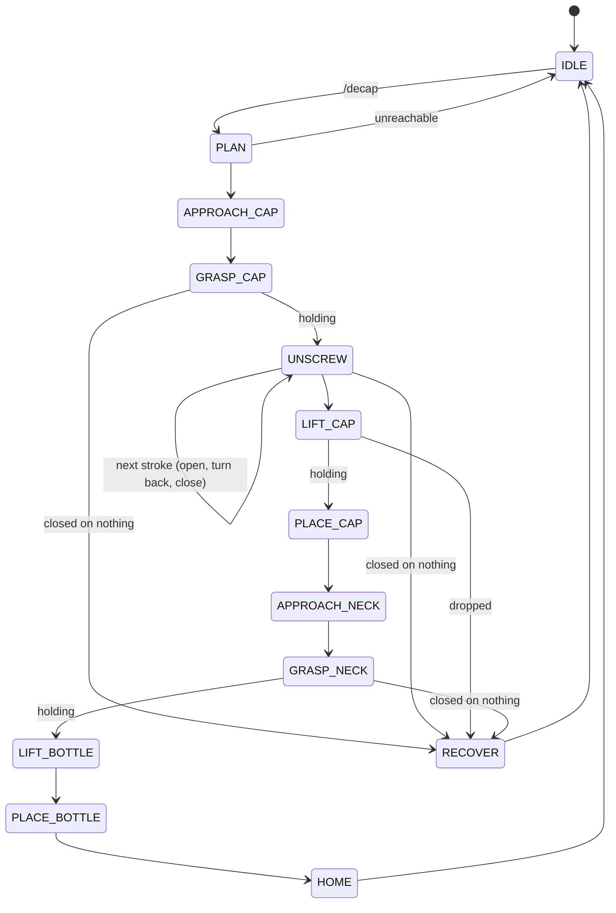

# Phase 2: bottle decapping

**Goal:** with one arm, unscrew the cap of a bottle and sort the cap and the bottle
into their boxes.

Package: [`ros2_ws/src/tasks/so101_decap`](../ros2_ws/src/tasks/so101_decap) ·
Fixture: [`hardware/bottle_fixture`](../hardware/bottle_fixture) ·
Sim scene: `scene_decap.xml` (generated by [`sim/tools/make_decap_scene.py`](../sim/tools/make_decap_scene.py))

| Stage | Content | Status |
|---|---|---|
| **v1** | Bottle already in the fixture: unscrew a loosened cap → cap to the cap box → bottle to the bottle box | ✅ simulation: 5/5 (`scripts/decap_demo.sh`), ~67 s each |
| v2 | Detect the bottle on the table, pick it up and insert it into the fixture | design |
| v3 (optional) | A factory-tight cap | not a goal |

---

## Setup decisions

### The robot stands on an 18 cm riser

Unscrewing means turning the gripper about the cap's axis, so the gripper has to point
straight down onto the cap. On the SO-101, a vertical gripper is only reachable up to
**z ≈ 8 cm** above the robot's base (`wrist_flex` limit). It can still go well *below*
the base (-12 cm). The bottle (Auchan 50 cl, 220 mm) has its cap centre at 21.5 cm, so
the robot sits on an 18 cm riser: the cap ends up at +3.5 cm in the robot frame, in the
middle of the reachable zone. A tilted cradle (bottle leaning at 45-60°) was the
alternative without a riser. It was rejected because inserting the bottle (v2) becomes
much harder.

### The fixture is passive: form closure on the bottle's feet

The base of a carbonated-drink bottle has 5 feet with V-grooves between them. The printed
cup has 5 thin wedge ribs that slot into the grooves. It has no moving parts and no
lock/unlock step, and the bottle cannot turn. A funnel at the opening absorbs a few mm of
placement error. In simulation, it holds **1 N·m** (about 10× a loosened cap) after
about 6° of play, without the bottle climbing over the ribs.

### Grip pads on the jaws (assumed)

Simulation showed that the stock jaws squeeze a small cylinder *out*, instead of holding
it: the moving jaw pivots, so the jaw faces are not parallel. Clip-on pads with a 28 mm
notch, lined with TPU or rubber, are assumed. In simulation they are stood in for by a
**grip assist** (`SO101Sim`): a weld that holds a part where it was grasped while both
jaws touch it and the gripper is closed. Contact friction is not what the sim validates.
The sim validates the motion, the timing and the logic.

### Measured gripper geometry

The TCP (`gripper_frame_link`) sits **on the fixed finger**, not between the jaws. A round
part of diameter *d* is held with its axis `fixed_jaw_face + d/2` (≈ 18 mm for the cap)
from the TCP, along the TCP x-axis. The TCP has to go `grasp_depth` = 8 mm below the part's
centre: higher up, only the fingertips touch and the part slips. The wrist-roll axis is
also 7.8 mm away from the TCP.

---

## Motion plan ([planner.py](../ros2_ws/src/tasks/so101_decap/so101_decap/planner.py))

Everything is solved before moving (≈ 0.2-0.9 s):

1. **Cap grasp.** Top-down, with the jaw direction chosen so that the wrist starts near
   the low end of its range: a stroke can then turn the gripper ~240°.
2. **Unscrewing strokes.** The whole gripper pose rotates about the **cap axis** (not the
   wrist axis) and rises by the thread pitch (2.7 mm/turn). Each point is solved with
   full-orientation IK. Between strokes: open → turn back (seeded at the stroke start,
   so the IK does not take the short way into the wrist limit) → close.
   1.5 turns = 3 strokes (240° + 240° + 60°).
3. **Cap lift.** Straight up 4 cm with the same orientation (the cap slides off the neck
   along its axis).
4. **Cap drop.** Prioritized IK. The **cap's axis**, not the TCP, is put above the box
   centre (the cap is 18 mm off the TCP), and it is released just above the rim.
5. **Neck grasp → lift 6 cm** (the bottle bottom clears the 38 mm cup) **→ bottle box**,
   with the bottle's axis on the box centre, lowered to 5 mm above the box floor, then
   released.

## State machine ([decap_node.py](../ros2_ws/src/tasks/so101_decap/so101_decap/decap_node.py))



**Grip checks:** closed on something, the jaws stop before fully closed (≈ 12-18 % on the
cap). Below `holding_min_pct` (3 %), the part was missed or dropped → **RECOVER**: open,
back off upward, go home, report.

**Open question: when is the cap free?** A fixed number of turns is used
(`unscrew_turns` = 1.5 for a 1.25-turn thread). Options to detect it: perception (the cap
no longer on the bottle), or a short lift test after each stroke. On a real bottle, a cap
that is out of its thread just sits loosely on the neck (it is hollow). It stays there
when the gripper opens and comes off with the lift. The simulated cap behaves the same:
engaged → loose → free.

## Simulation model

| | |
|---|---|
| Thread | hinge + slide coupled by the pitch, friction torque = tightness (0.03 N·m, loosened) |
| After 1.25 turns | loose: the thread is off, it spins and slides up the neck freely |
| Lifted 6 mm | free body (swapped in at the same pose) |
| Bottle | Ø60, 5 capsule feet, stepped shoulder, neck Ø25, 100 ml of water (steadier) |
| `/reset_object` | everything back in place, cap screwed |

## Perception (v2)

The bottle on the table: YOLO (COCO `bottle`) in the perception container, or the cap's
colour (green) as in the earlier bottle experiments. Pixel → 3D with the plane assumption
(`so101_vision`), at the cap's height. The camera pose comes from the ArUco marker on
the real setup.

## Known limits

- **Gripper force and pads.** Not validated by the sim (grip assist). First real test:
  close the gripper on a loosened cap and turn only the wrist.
- **Cap tightness.** A loosened cap only. A factory-tight cap is out of scope.
- **Placement accuracy in the bottle box.** ~3 cm off-centre in simulation, inside the
  12 cm box. To tighten.

## Try it (simulation)

```bash
TASK=decap USE_SIM=true docker compose up -d          # from docker/
ros2 service call /decap std_srvs/srv/Trigger
ros2 topic echo /decap/result
ros2 service call /reset_object std_srvs/srv/Trigger  # bottle back in the fixture, cap on
```

Or `scripts/decap_demo.sh --runs 5`, which resets, triggers and reports each run.

The motion can be checked without ROS: `sim/tools/decap_feasibility.py`.
