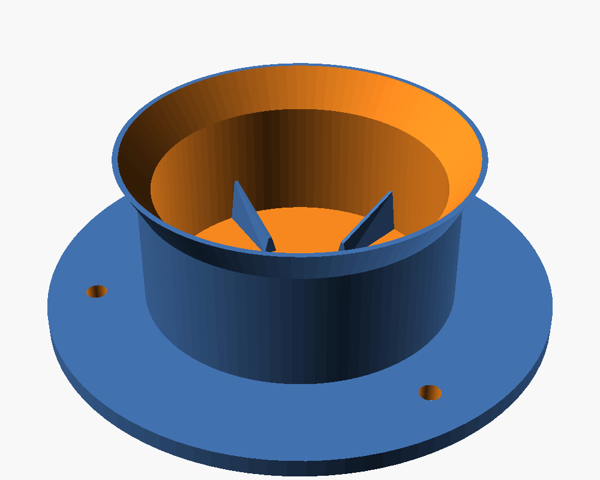
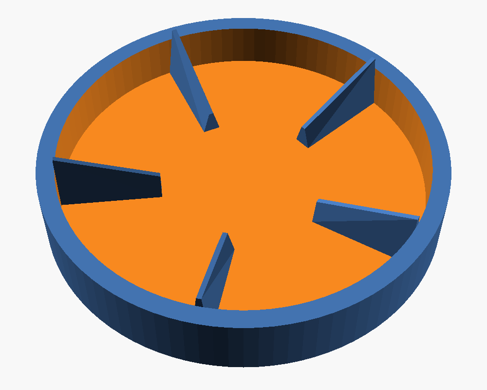

# Bottle fixture

Holds a petaloid-base bottle (5 feet, e.g. a 50 cl sparkling-water bottle) upright, and
stops it from turning while the arm unscrews the cap. Five wedge ribs on the floor slot
into the grooves between the bottle's feet. No moving parts.

| Preview | Fit test |
|---|---|
|  |  |

## Print

1. **Print `coupon.stl` first** (floor + ribs + a low ring, ~15 min). Drop the bottle
   in: it must seat flat, with a little play when turned, then lock. If it doesn't go in,
   lower `rib_h_out` / `rib_w`. If it is loose, raise `clearance` or `rib_w`.
2. Then print `fixture.stl`. Floor down, no supports, 3 perimeters, 20 % infill. PLA
   works; PETG is tougher for the thin ribs.
3. Fix it to the table (3 × M4, or double-sided tape) at the position set in
   `ros2_ws/src/tasks/so101_decap/config/decap.yaml` (`fixture_xy`).

## Change it

Every dimension is a named parameter at the top of
[`bottle_fixture.scad`](bottle_fixture.scad), in mm. Edit it in OpenSCAD (File → Export →
STL), or from the command line:

```bash
openscad -o fixture.stl bottle_fixture.scad
openscad -D 'part="coupon"' -o coupon.stl bottle_fixture.scad
openscad -D 'bottle_d=65' -D 'feet=5' -o fixture.stl bottle_fixture.scad   # another bottle
```

The simulation uses the same dimensions (`sim/tools/make_decap_scene.py`): change both
together.
